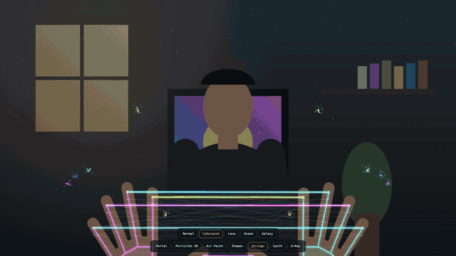

<h1 align="center">AirMesh</h1>

<p align="center">
  <a href="https://arvanj.github.io/airmesh/media/airmesh-launch.mp4"></a>
  <br><sub>▶ Click for the full narrated launch video with sound</sub>
</p>

<p align="center"><b>Browser hand-tracking playground built by <a href="https://github.com/ArvanJ">@ArvanJ</a>, turning any webcam into an <a href="https://arvanj.github.io/airmesh/">Iron Man–style holographic workshop</a></b></p>

<p align="center">
  
  
  
  
</p>

<p align="center">
  <a href="https://arvanj.github.io/airmesh/">Live Demo</a> ·
  <a href="https://arvanj.github.io/airmesh/media/airmesh-launch.mp4">Launch Video</a> ·
  <a href="#modes">Modes</a> ·
  <a href="#portal-filters">Portal Filters</a> ·
  <a href="#how-it-works">How It Works</a>
</p>

---

**Control a holographic workshop with your bare hands.** AirMesh is a browser playground that uses your webcam and computer vision to track both hands in real time. You can open camera-filter portals, sculpt 3D particles, paint in the air, weave neon strings, play a synthesizer and pull apart engines and cars like Tony Stark.

### ▶ Live: **https://arvanj.github.io/airmesh/**

There is nothing to install. Open the link, allow the camera, and raise your hands. Use desktop Chrome, Edge or Safari with a webcam.

---

## Modes

Switch modes by hovering a fingertip over the bottom bar for about 0.7 seconds, by clicking, or with keys **1–9**.

**Record a clip** in any mode with the **● REC** button in the top-right corner (or press **R**). Press it again to stop, and the video downloads. If the sound is on when you start, it's recorded too.

| # | Mode | What your hands do |
|---|------|--------------------|
| 1 | **Portal** | Make an "L" with your thumb and index finger on **both** hands. The space between them becomes a live camera filter. **Tap thumb + index together** to switch to the next filter (or press **E**). |
| 2 | **Particles 3D** | **Tap thumb + index together** to switch to the next model: torus knot, DNA, galaxy, sphere, heart, **Your hand** (the particles copy your hand live, in 3D) or **You** (your whole silhouette, from person segmentation). Move your right hand to spin it, spread both hands to zoom, and pinch and hold to explode it. |
| 3 | **Air Paint** | Pinch thumb and index to draw glowing strokes. Hold a fist to clear (or press **C**). **K** turns on a kaleidoscope. |
| 4 | **Shapes** | A glowing shape rides your palm. **Pass it hand to hand:** pinch with your empty hand and it flies over in an arc, morphing into the next shape and colour mid-air, then bursts into sparks when you catch it. Spread the thumb and index of the hand holding it to make it bigger, and close them to shrink it. With one hand, 1–5 fingers pick the shape and a pinch sets the brightness. |
| 5 | **Strings** | Your fingertips are strung together with neon light. **Curl a finger to pluck its string.** Longer strings play lower notes, and the string wobbles. Pick a theme: Normal, Cyberpunk, Lava, Ocean or Galaxy (or press **T** to cycle). Click once to turn on sound. |
| 6 | **Synth** | Your left hand's height plays notes on a pentatonic scale. An open hand plays and a fist mutes. Your right hand controls the filter, echo and vibrato (pinch). **Chords:** hold up 1–4 right-hand fingers for power, major, minor or seventh chords; an open hand plays single notes. Five live visualizers read the real audio: **Spectrum**, **Ring**, **Scope**, **Orbit** (an X/Y phase scope, so a sine draws a circle and a square draws a square) and **Sphere** (press **V**). Add a **drum machine** to play over: Four, Hip-hop or Breaks at 110 BPM (press **B**). **Rec loop** (or **L**) records 2 bars of what you play in time with the beat, then loops it under you while you jam. Click once (or press **M**) to turn on audio. |
| 7 | **Sky** | Move the heavens. Raise both arms and a long-exposure star-trail sky starts turning; turn your hands like a steering wheel to spin it faster (or sweep one hand). **Flick a finger** to launch a shooting star. **Point** (index out, other fingers curled) and move to draw a constellation, which then turns with the sky. Person segmentation keeps *you* in front of the stars, standing on moonlit dunes. |
| 8 | **X-Ray** | A holographic 3D workshop. One open hand rotates the model, a pinch zooms and spreading both hands explodes it into parts. Point at a part to see what it does. Pick a car or machine from the dropdown in the bottom-right. |
| 9 | **Keep-up** | A mini game. Bounce glowing balls off your palms and don't let them drop. Swing up into a ball for a bigger hit. Every 10 hits adds another ball, and your best streak is saved. |

### Portal filters
Blueprint · Thermal · Matrix · Pop art · X-ray · **Neon edges** · **Cartoon** · **Sketch** · **Emboss** · **Night vision** · **Glitch** · **Cutout** · **Ghost** · **Invisible** · **Predator** · **Echo**

- **Neon edges, Cartoon, Sketch and Emboss** use OpenCV-style image processing: a 3×3 Sobel gradient computed on every frame.
- **Glitch** tears the colour channels sideways in random bands, like a corrupted video signal.
- **Cutout, Ghost, Invisible, Predator and Echo** use MediaPipe selfie segmentation to separate you from the background. The mask is grown by 2px with a max filter (like `cv.dilate`) to hide your outline.
  - **Cutout:** puts you in space.
  - **Ghost:** shows you as a heat signature over a blueprint world.
  - **Invisible:** makes you disappear. AirMesh learns the background wherever you *aren't* standing and paints it over you. Any part it has never seen gets filled in from the surroundings (push-pull inpainting, in the spirit of `cv.inpaint`), so you vanish right away and the fill sharpens as you sway side to side.
  - **Predator:** a cloaking-device look. You turn see-through, the background bends through your outline and the edges shimmer.
  - **Echo:** leaves rainbow afterimages behind you as you move.

### X-Ray models
- **Built in, animated:** F1 car (V6 hybrid, DRS, glowing brakes), running inline-4 engine (firing order 1-3-4-2) and jet engine.
- **Streamed glTF:** Ferrari 458, Car Concept, Dune Buggy, Cartoon Car, Toy Car, Milk Truck, Toy Truck, Motorcycle, Road Bike, Carbon Wheel, 2-Cylinder Engine, Gearbox and Reciprocating Saw.

X-Ray keys: **X** explode · **H** hologram/solid · **+ / −** zoom · **↑ / ↓** rpm

---

## How it works

- **Hand tracking:** [MediaPipe Tasks Vision](https://ai.google.dev/edge/mediapipe/solutions/vision/hand_landmarker) HandLandmarker gives 21 landmarks per hand for 2 hands. It runs in a **Web Worker** (`tracker.js`) so inference never blocks drawing. Results are smoothed toward the newest detection every frame, which keeps motion fluid at 60–120 Hz.
- **Segmentation:** MediaPipe ImageSegmenter (selfie model). It runs only while a Cutout or Ghost portal is active.
- **Rendering:** a Canvas 2D overlay on the mirrored camera feed. X-Ray uses [three.js](https://threejs.org) with a custom fresnel and scanline hologram shader, plus glTF, Draco and KTX2 loaders.
- **Audio:** the Web Audio API. Two detuned oscillators and a sub oscillator feed a resonant low-pass filter and a feedback delay. An analyser drives the particle sphere.
- **No build step, no backend:** just `index.html` + `tracker.js`. All libraries and models load from public CDNs.

### Privacy
Everything runs **locally in your browser**. Camera frames are never uploaded anywhere.

## Run it locally

The camera needs `localhost` or HTTPS, so use a local server rather than opening the file directly:

```bash
python3 -m http.server 8000
```

Then open http://localhost:8000.

If you change `tracker.js`, bump the `?v=` number in `new Worker("tracker.js?v=…")` in `index.html`. Otherwise browsers may keep the cached worker for about 10 minutes.

## Credits

- Hand tracking and segmentation: [Google MediaPipe](https://github.com/google-ai-edge/mediapipe) (Apache 2.0)
- 3D engine: [three.js](https://github.com/mrdoob/three.js) (MIT)
- 3D models are streamed from their original hosts and keep their own licences. Some require attribution, so see each source for the author and licence:
  - [KhronosGroup glTF-Sample-Models](https://github.com/KhronosGroup/glTF-Sample-Models) and [glTF-Sample-Assets](https://github.com/KhronosGroup/glTF-Sample-Assets): Car Concept, Dune Buggy, Toy Car, Milk Truck, 2-Cylinder Engine, Gearbox, Reciprocating Saw
  - [three.js examples](https://github.com/mrdoob/three.js/tree/dev/examples/models/gltf): Ferrari 458, Road Bike
  - [Babylon.js assets](https://github.com/BabylonJS/Assets): Cartoon Car, Carbon Wheel
  - [Kenney Starter Kit Racing](https://github.com/KenneyNL/Starter-Kit-Racing) (CC0): Toy Truck, Motorcycle
- The F1 car, engine and jet engine are procedural models built in code for this project.
